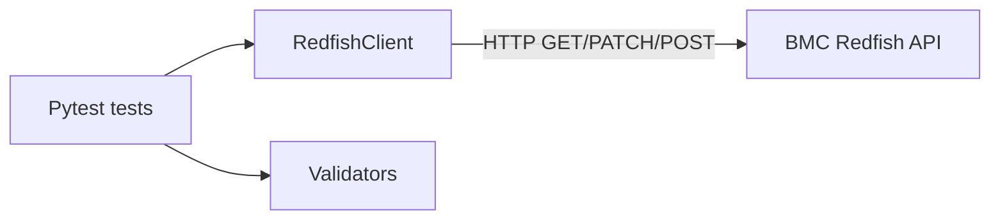
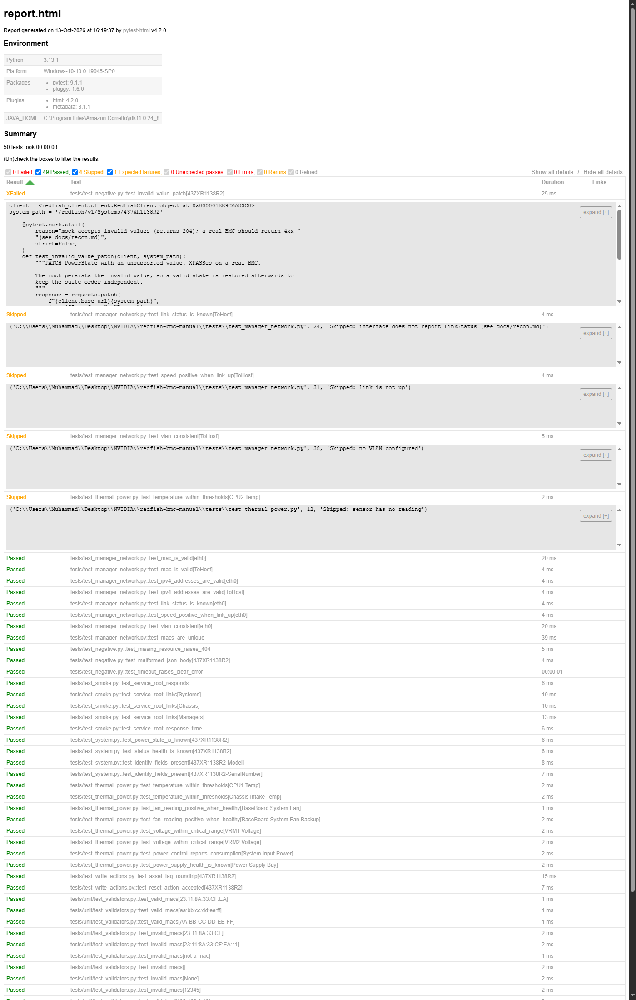

# Redfish BMC Test Suite

[](https://github.com/muhammad6535/Redfish-BMC-Test-Suite/actions/workflows/ci.yml)

Automated Pytest suite that validates a server BMC through the DMTF Redfish API.

## Why it matters

A BMC (Baseboard Management Controller) is the small computer inside a server that manages
the hardware out-of-band: power, cooling, sensors and network. Hardware teams test it
constantly, because a BMC that reports wrong data or ignores commands can take down a whole
rack. This project tests one the way a QA engineer would, against a free mock BMC, so
everything runs on a laptop.

## Architecture



Tests never call the BMC directly; they go through one `RedfishClient`, so changing `BMC_URL`
points the same suite at real hardware. The client handles HTTP, timeouts and link-following;
the validators hold the checks (MAC, IP, ranges); the tests only describe what should be true.

## What is tested

- **Smoke** - the service root responds and advertises Systems, Chassis, Managers.
- **Functional (system)** - power state, health and identity fields are present and valid.
- **Network** - each BMC Ethernet interface has a valid, unique MAC, valid IPv4, a known link
  status, positive speed when up, and consistent VLAN settings.
- **Thermal and power** - temperatures within thresholds, fans spinning when healthy,
  voltages within range, power consumption reported, and power supply health is a valid state.
- **Write and actions** - PATCH the system AssetTag and restore it; POST a Reset action.
- **Negative** - missing resources, malformed JSON and timeouts fail clearly, never hang.

## How to run

**Windows (PowerShell):**

```powershell
python -m venv .venv
.venv\Scripts\activate
pip install -r requirements.txt
git clone --depth 1 https://github.com/DMTF/Redfish-Mockup-Server.git ../Redfish-Mockup-Server
pytest
```

**macOS / Linux:**

```bash
python3 -m venv .venv
source .venv/bin/activate
pip install -r requirements.txt
git clone --depth 1 https://github.com/DMTF/Redfish-Mockup-Server.git ../Redfish-Mockup-Server
pytest
```

Point the same suite at a real BMC. On Linux/macOS:

```bash
BMC_URL=https://my-bmc.example.com pytest
```

On Windows PowerShell:

```powershell
$env:BMC_URL="https://my-bmc.example.com"; pytest
```

Real BMCs usually need credentials and often use a self-signed certificate, so the client
also reads `BMC_USER`, `BMC_PASSWORD`, and `BMC_VERIFY_TLS=false`.

Run one category with markers: `pytest -m smoke`, `pytest -m network`, etc.

## Sample report

`pytest` writes an HTML report to `reports/report.html`. A copy from a local run (49 passed,
4 skipped, 1 xfailed - the skips are documented mock limitations; the xfail is a known bug:
the mock accepts an invalid `PowerState` instead of returning a 4xx):



CI uploads the same report as a downloadable artifact on every run.

## Repository layout

```
src/redfish_client/   client.py, validators.py
tests/                conftest.py, test_*.py, unit/
docs/                 test_plan.md, bug_report_template.md, recon.md, report-screenshot.png
.github/workflows/    ci.yml
```
